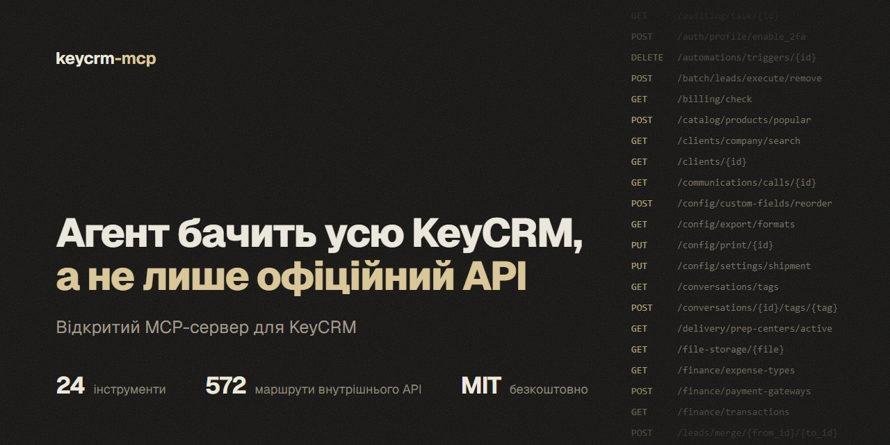
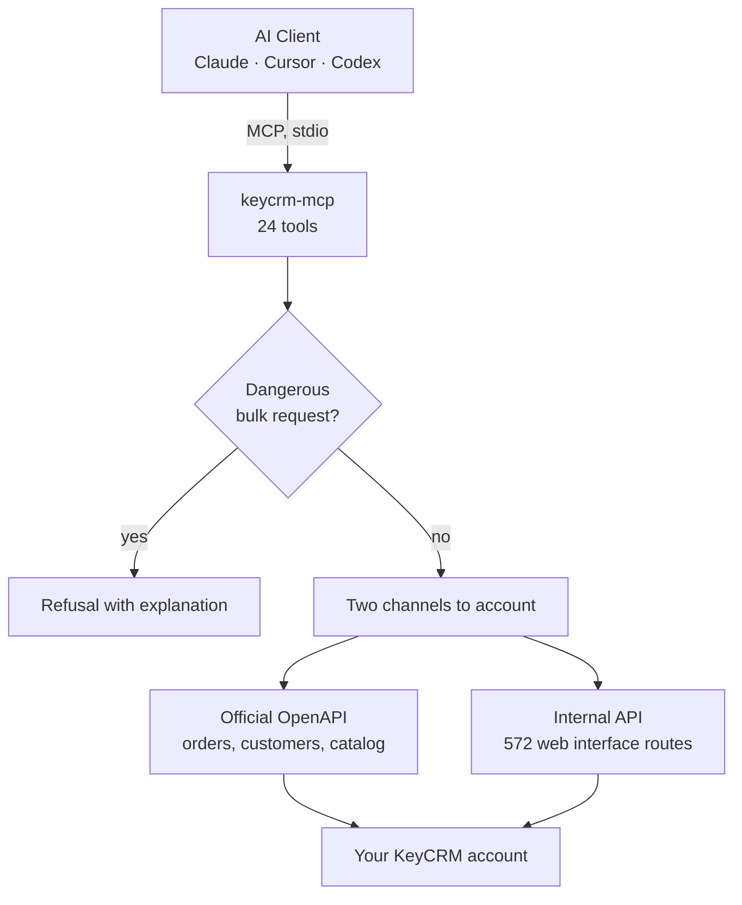

# KeyCRM MCP: Unofficial MCP Server for KeyCRM

[Українська](README.md) · [Русский](README.ru.md) · **English**

[](https://github.com/IgorShutko/keycrm-mcp/actions/workflows/ci.yml)
[](LICENSE)
[](https://www.python.org/)
[](https://modelcontextprotocol.io/)
[](docs/TOOLS.md)
[](docs/API_REFERENCE.md)



**KeyCRM MCP** (`keycrm-mcp`): free open-source [MCP](https://modelcontextprotocol.io/) server that connects Claude, Cursor, Codex, and other AI agents to [KeyCRM](https://keycrm.app/). The server runs on your computer and gives the agent access to leads and pipelines, orders, customers, products, inventory, tasks, chats, finances, and settings. It combines the official OpenAPI with the web interface's internal API: 572 routes not documented in the official documentation.

> **Unofficial project.** KeyCRM MCP is not a product of KeyCRM, is not affiliated with it, and is not supported by it. The internal API is undocumented: KeyCRM may change it with any interface update. Always test new scenarios on a test account first.

- **24 tools** instead of hundreds of small ones: each covers an entire entity via the `action` parameter.
- **Two channels to one account.** Official OpenAPI for orders, customers, and catalog; internal API for everything else. The server automatically selects the appropriate channel.
- **572 internal API routes** in a searchable catalog. If a dedicated tool is missing, the agent finds the route and calls it directly.
- **Safeguards.** Deleting pipeline lead cards is blocked at the server level; dangerous bulk requests are also restricted. Before risky actions, the agent takes a local account snapshot.
- **Local.** The server runs via stdio, credentials are stored in environment variables, and there is no telemetry.

## Table of Contents

- [Quick Start](#quick-start)
- [Features](#features)
- [Configuration](#configuration)
- [Protection Against Accidental Changes](#protection-against-accidental-changes)
- [Platform Limitations](#platform-limitations)
- [Security](#security)
- [How It Works](#how-it-works)
- [FAQ](#faq)
- [Development](#development)
- [Author and Contacts](#author-and-contacts)
- [License](#license)

Documentation (in Russian): [quick start](docs/QUICKSTART.md) · [tools reference](docs/TOOLS.md) · [map of both APIs](docs/API_REFERENCE.md) · [how we reverse-engineered the internal API](docs/REVERSE_ENGINEERING.md) · [Python recipes](docs/COOKBOOK.md) · [status of all 572 routes](docs/ENDPOINTS_STATUS.md).

## Quick Start

**1. Requirements.** [uv](https://docs.astral.sh/uv/getting-started/installation/) (it installs Python 3.11 or newer automatically) and Git.

**2. Credentials.** Account subdomain (for `myshop.keycrm.app` it is `myshop`), KeyCRM user email, and password. The server has been tested with an account owner's credentials.

**3. Connect the AI client.** Cloning the repository is not required.

Claude Code:

```bash
claude mcp add keycrm -s user -e KEYCRM_DOMAIN=myshop -e KEYCRM_EMAIL=you@example.com -e KEYCRM_PASSWORD=REPLACE_ME -- uvx --from git+https://github.com/IgorShutko/keycrm-mcp keycrm-mcp
```

Codex:

```bash
codex mcp add keycrm --env KEYCRM_DOMAIN=myshop --env KEYCRM_EMAIL=you@example.com --env KEYCRM_PASSWORD=REPLACE_ME -- uvx --from git+https://github.com/IgorShutko/keycrm-mcp keycrm-mcp
```

Claude Desktop (`claude_desktop_config.json`), Cursor (`~/.cursor/mcp.json`), Windsurf, and most other clients:

```json
{
  "mcpServers": {
    "keycrm": {
      "command": "uvx",
      "args": ["--from", "git+https://github.com/IgorShutko/keycrm-mcp", "keycrm-mcp"],
      "env": {
        "KEYCRM_DOMAIN": "myshop",
        "KEYCRM_EMAIL": "you@example.com",
        "KEYCRM_PASSWORD": "REPLACE_ME"
      }
    }
  }
}
```

To pin a version, add the tag to the URL: `git+https://github.com/IgorShutko/keycrm-mcp@v0.1.0`. The first run downloads dependencies, which takes up to half a minute.

**4. Try it.** Ask the agent:

- *"Check the connection to KeyCRM and show how many leads, orders, and products are in the account."*
- *"Show the pipeline: how many cards in each status and what is the conversion rate."*
- *"Find the card by phone +380501234567 and tell me its status."*
- *"Which cards have been stagnant for more than 7 days? Group them by managers."*
- *"Create a lead in pipeline 1: Ivan, +380501234567, budget 5000, next contact tomorrow at 12:00."*
- *"Who and what changed in card 63? Show the history."*

## Features

| Tool | Description |
|---|---|
| `crm_status` | Profile, status of both channels, account counters. Start the session with this. |
| `leads` | Leads and pipelines: list, create, update, move between statuses, products in card, copy. |
| `orders` | Orders: list, create, statuses, payments, expenses, products, tags, sources. |
| `clients` | Customers: search, create, update, order and lead history. |
| `products` | Products, categories, warehouses. |
| `tasks` | Tasks: list, search, create, complete, overdue. |
| `conversations` | Chats: list, messages, unread, send. |
| `users` | Users, roles, permissions. |
| `report` | Reports: sales, leads, pipeline with conversion, manager workload, stuck cards. |
| `audit` | Change history: who, what, and when changed in the account, entity, or by manager. |
| `settings` | Account settings by section. |
| `finance` | Bills, accounts, payments, expense types, payment methods, currency rates, fiscalization, billing. |
| `delivery` | Nova Poshta, Ukrposhta, and Rozetka Delivery directories: cities, branches, streets, cost calculation. |
| `stocks` | Stock levels, movements, inventory counts, warehouse statistics. |
| `documents` | Documents via Twig template: view and real PDF. |
| `files` | Order attachments: upload in chunks up to 250 MB, download, detach. |
| `custom_fields` | Custom fields: field descriptions and values in cards. |
| `comments` | Comments for leads, orders, customers, and deals. |
| `automations` | Triggers and automations, read-only. |
| `publications` | Product publications on marketplaces. |
| `crm_api` | Request to any route of both APIs, protected from dangerous bulk paths. |
| `crm_endpoints` | Search the catalog of 572 internal routes. |
| `crm_capabilities` | Which account modules are active, limits, known issues, and dangerous areas. |
| `crm_snapshot` | Local JSON snapshot of cards, orders, products, customers, and directories before risky actions. |

All actions and parameters for each tool: [tools reference](docs/TOOLS.md) (in Russian).

## Configuration

The server takes parameters from environment variables or from a `.env` file next to the code (template: [`.env.example`](.env.example)).

| Variable | Default | Purpose |
|---|---|---|
| `KEYCRM_DOMAIN` | none, required | Account subdomain: `myshop` for `myshop.keycrm.app`. |
| `KEYCRM_EMAIL` | none | Login for the internal API. |
| `KEYCRM_PASSWORD` | none | Password for the internal API. |
| `KEYCRM_API_TOKEN` | auto-detected | Official OpenAPI key. If empty, the server retrieves it from account settings via the internal API. |
| `KEYCRM_DATA_DIR` | code directory | Where to store snapshots (`backups/`) and downloaded files and PDFs (`exports/`). Specify your folder when running via `uvx`. |
| `KEYCRM_OPENAPI_BASE` | `https://openapi.keycrm.app/v1` | Official API address. |

If credentials are missing, the server still starts and shows tools, but calls will explain what is missing.

## Protection Against Accidental Changes

- **The server does not delete pipeline cards.** `leads(action="remove")` returns an error with an explanation. Reason: the internal bulk deletion route wipes every card in the selected columns when the filter is not exact. During development, 26 cards disappeared and were restored from a snapshot. Analysis: [docs/INCIDENT.md](docs/INCIDENT.md).
- **Dangerous bulk paths are closed.** `crm_api` does not allow `/batch/leads/execute/remove` or any batch requests with the `column_ids` parameter.
- **Snapshot before risk.** `crm_snapshot` saves the account to a local JSON. Keys, tokens, and passwords in the snapshot are masked.
- **Honest errors.** The server returns the status and text response from KeyCRM, not fabricated results. On 401, it logs in again automatically; on 429, it waits and retries up to three times.
- **Read-only automations.** The API cannot create pipelines, statuses, fields, sources or triggers: set them up in the KeyCRM interface.

## Platform Limitations

These limitations come from KeyCRM, not the server, and were measured on a live account:

- **List page is no larger than 50 records.** Internal lists accept `page` and `per_page`; the `limit` parameter is mostly ignored.
- **`orderBy` does not sort.** On `/leads`, `/tasks`, and `/catalog/products`, the order is the same for asc and desc; on several other lists, the parameter returns 500. Sort on your side.
- **Internal order list can be empty** even when orders exist. Therefore `orders.list` reads the official API.
- **Limits differ.** Official key: 20 requests per minute. Internal API handles about 120.
- **Some routes return 500 on KeyCRM's side:** `/finance/payments`, `/finance/transactions`, `/delivery/addresses/suggest`.
- **Disabled modules return empty lists.** If orders, chats, or companies are not activated in the account, an empty response does not mean data loss. Check via `crm_capabilities`.
- **Bulk deletion of orders is asynchronous:** the object disappears after 2-5 seconds.
- **All dates are in UTC.**

Full list with details: [docs/REVERSE_ENGINEERING.md](docs/REVERSE_ENGINEERING.md) and [docs/API_REFERENCE.md](docs/API_REFERENCE.md) (in Russian).

## Security

- Keep credentials in environment variables or in the `.env` file. Do not paste them into agent requests or tool arguments. `.env`, `backups/`, and `exports/` are added to gitignore.
- The server connects only to `<your-subdomain>.api.keycrm.app` and `openapi.keycrm.app`. There is no telemetry.
- Tokens are stored only in process memory.
- `crm_snapshot` snapshots contain phone numbers, amounts, and customer correspondence in plain text. Keep the `backups/` folder local.
- If the API key was compromised, regenerate it in KeyCRM settings. If the password was compromised, change the password.
- When reporting errors, do not paste real customer data or credentials into issues.
- Security model and where to report vulnerabilities: [SECURITY.md](SECURITY.md).

## How It Works



1. **Official OpenAPI** (`openapi.keycrm.app/v1`): key-based `Bearer` authorization. Documented and stable, but covers only part of the CRM: 59 operations. The server finds the key itself in account settings.
2. **Internal API** (`<subdomain>.api.keycrm.app`): the same one used by the KeyCRM web interface. Login via email and password through `POST /auth/login`, token lives for 24 hours and updates automatically. A map of 572 routes in 41 groups was recovered from the JavaScript build of interface version v33.0.10 and is stored in [`endpoints.json`](endpoints.json).

How we recovered the internal API, where it behaves differently from the official one, and how to repeat the reconnaissance on a new version: [docs/REVERSE_ENGINEERING.md](docs/REVERSE_ENGINEERING.md) (in Russian).

## FAQ

### What is KeyCRM MCP?

KeyCRM MCP implements the Model Context Protocol for KeyCRM. An AI agent connected to it reads and modifies the CRM via 24 tools: leads and pipelines, orders, customers, products, inventory, tasks, chats, finances, documents, and settings. The open-source server runs locally.

### Is KeyCRM MCP an official KeyCRM product?

No. KeyCRM MCP is developed independently and is not affiliated with KeyCRM. The server uses the official OpenAPI, and everything else is done using the same requests sent by the web interface. These internal requests can change at any time.

### How does KeyCRM MCP differ from the official KeyCRM API?

The official OpenAPI has 59 operations and covers orders, customers, products, and part of the pipelines. The web interface's internal API has 572 routes: tasks, comments, change history, custom fields, files, documents, delivery directories, warehouse analytics, settings. KeyCRM MCP works with both and automatically selects the more reliable channel for each action.

### Which AI assistants work with KeyCRM MCP?

Any MCP client that can run a local stdio server: Claude Code, Claude Desktop, Cursor, OpenAI Codex, Windsurf, VS Code with GitHub Copilot, Gemini CLI, Zed, Cline, and others.

### What is needed to connect KeyCRM?

uv, Git, account subdomain, KeyCRM user email, and password. Add the server to the AI client with one command from the "Quick Start" section.

### Is it safe to give an AI agent access to the CRM?

The server blocks the most dangerous operations: deleting pipeline cards and bulk requests that could wipe data. Before risky actions, the agent can take a local account snapshot. All other writes run immediately, so always test new scenarios on a test account first, and keep confirmation enabled in the client before calling write tools.

### Can I call a route for which there is no dedicated tool?

Yes. `crm_endpoints` searches the catalog of 572 routes, and `crm_api` executes a request to any of them. The verification status of each route: [docs/ENDPOINTS_STATUS.md](docs/ENDPOINTS_STATUS.md).

### How much does KeyCRM MCP cost?

KeyCRM MCP is free and distributed under the MIT license. You only pay for your KeyCRM plan and the AI client you use.

## Development

```bash
git clone https://github.com/IgorShutko/keycrm-mcp.git
cd keycrm-mcp
uv run python test_offline.py
```

`test_offline.py` does not require an account: it checks that the server imports correctly, registers all 24 tools, and clearly reports missing credentials. CI runs this same check on Python 3.11 and 3.13.

Other tests work with a live account: copy `.env.example` to `.env` and enter your credentials. Run them only on a test account.

- `test_smoke.py`: 92 checks via stdio, including a full cycle of creating, updating, and deleting a customer, product, and order with cleanup.
- `test_domains.py`: 90 checks for domain tools.
- `test_actions.py`: 83 calls to read all actions, results in [docs/ACTION_MATRIX.md](docs/ACTION_MATRIX.md).

Without an MCP client, you can use `crm_cli.py`: `uv run python crm_cli.py status`, `uv run python crm_cli.py search-endpoints tags`.

MCP clients start the server once, so restart the client after changing the code. Do not publish real customer data in issues, logs, and test files.

## Author and Contacts

KeyCRM MCP is created and maintained by Igor Shutko, [Target+](https://www.targetplus-agency.com/) agency. Related project: [Horoshop MCP](https://github.com/IgorShutko/horoshop-mcp) for stores on Horoshop.

- Telegram: [@shutko_igor](https://t.me/shutko_igor)
- Telegram channel: [@shutko_ads](https://t.me/shutko_ads)

Bugs and feature requests: [GitHub Issues](https://github.com/IgorShutko/keycrm-mcp/issues).

## License

[MIT](LICENSE).
