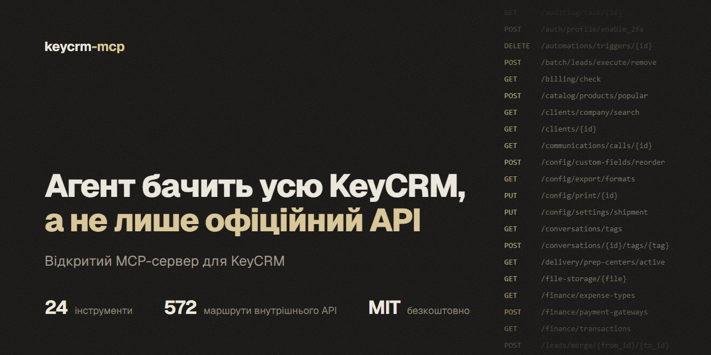
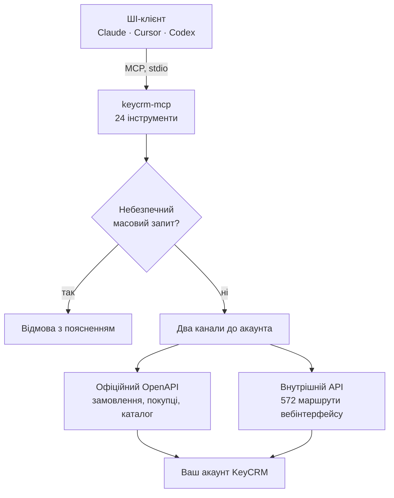

# KeyCRM MCP: неофіційний MCP-сервер для KeyCRM

**Українська** · [Русский](README.ru.md) · [English](README.en.md)

[](https://github.com/IgorShutko/keycrm-mcp/actions/workflows/ci.yml)
[](LICENSE)
[](https://www.python.org/)
[](https://modelcontextprotocol.io/)
[](docs/TOOLS.md)
[](docs/API_REFERENCE.md)



**KeyCRM MCP** (`keycrm-mcp`): безкоштовний [MCP](https://modelcontextprotocol.io/)-сервер з відкритим кодом, який підключає ШІ-агентів Claude, Cursor, Codex та інших до [KeyCRM](https://keycrm.app/). Сервер працює на вашому комп'ютері й дає агенту ліди та воронки, замовлення, покупців, товари, склад, задачі, чати, фінанси й налаштування. Він поєднує офіційний OpenAPI з внутрішнім API вебінтерфейсу: 572 маршрути, яких в офіційній документації немає.

> **Неофіційний проєкт.** KeyCRM MCP не є продуктом компанії KeyCRM, не пов'язаний з нею і нею не підтримується. Внутрішній API недокументований: KeyCRM може змінити його з будь-яким оновленням інтерфейсу. Нові сценарії спершу перевіряйте на тестовому акаунті.

- **24 інструменти** замість сотень дрібних: кожен покриває цілу сутність через параметр `action`.
- **Два канали до одного акаунта.** Офіційний OpenAPI для замовлень, покупців і каталогу, внутрішній API для всього іншого. Сервер сам обирає потрібний.
- **572 маршрути внутрішнього API** в каталозі з пошуком. Якщо окремого інструмента немає, агент знаходить маршрут і викликає його напряму.
- **Запобіжники.** Видалення карток воронки заблоковане на рівні сервера, небезпечні масові запити теж. Перед ризикованою дією агент робить локальний знімок акаунта.
- **Локально.** Сервер працює через stdio, доступи лежать у змінних середовища, телеметрії немає.

## Зміст

- [Швидкий старт](#швидкий-старт)
- [Можливості](#можливості)
- [Налаштування](#налаштування)
- [Захист від помилкових змін](#захист-від-помилкових-змін)
- [Обмеження платформи](#обмеження-платформи)
- [Безпека](#безпека)
- [Як це працює](#як-це-працює)
- [Часті запитання](#часті-запитання)
- [Розробка](#розробка)
- [Автор і контакти](#автор-і-контакти)
- [Ліцензія](#ліцензія)

Документація (російською): [швидкий старт](docs/QUICKSTART.md) · [довідник інструментів](docs/TOOLS.md) · [карта двох API](docs/API_REFERENCE.md) · [як відновлювали внутрішній API](docs/REVERSE_ENGINEERING.md) · [рецепти на Python](docs/COOKBOOK.md) · [статус усіх 572 маршрутів](docs/ENDPOINTS_STATUS.md).

## Швидкий старт

**1. Що потрібно.** [uv](https://docs.astral.sh/uv/getting-started/installation/) (він сам поставить Python 3.11 або новіший) і Git.

**2. Доступи.** Піддомен акаунта (для `myshop.keycrm.app` це `myshop`), e-mail і пароль користувача KeyCRM. Сервер перевірений під обліковим записом власника акаунта.

**3. Підключіть ШІ-клієнт.** Клонувати репозиторій не потрібно.

Claude Code:

```bash
claude mcp add keycrm -s user -e KEYCRM_DOMAIN=myshop -e KEYCRM_EMAIL=you@example.com -e KEYCRM_PASSWORD=REPLACE_ME -- uvx --from git+https://github.com/IgorShutko/keycrm-mcp keycrm-mcp
```

Codex:

```bash
codex mcp add keycrm --env KEYCRM_DOMAIN=myshop --env KEYCRM_EMAIL=you@example.com --env KEYCRM_PASSWORD=REPLACE_ME -- uvx --from git+https://github.com/IgorShutko/keycrm-mcp keycrm-mcp
```

Claude Desktop (`claude_desktop_config.json`), Cursor (`~/.cursor/mcp.json`), Windsurf та більшість інших клієнтів:

```json
{
  "mcpServers": {
    "keycrm": {
      "command": "uvx",
      "args": ["--from", "git+https://github.com/IgorShutko/keycrm-mcp", "keycrm-mcp"],
      "env": {
        "KEYCRM_DOMAIN": "myshop",
        "KEYCRM_EMAIL": "you@example.com",
        "KEYCRM_PASSWORD": "REPLACE_ME"
      }
    }
  }
}
```

Щоб закріпити версію, додайте тег до адреси: `git+https://github.com/IgorShutko/keycrm-mcp@v0.1.0`. Перший запуск завантажує залежності, це займає до пів хвилини.

**4. Спробуйте.** Попросіть агента:

- *«Перевір підключення до KeyCRM і покажи, скільки в акаунті лідів, замовлень і товарів.»*
- *«Покажи воронку: скільки карток у кожному статусі та яка конверсія.»*
- *«Знайди картку за телефоном +380501234567 і скажи, на якому вона статусі.»*
- *«Які картки зависли без руху понад 7 днів? Згрупуй за менеджерами.»*
- *«Створи лід у воронці 1: Іван, +380501234567, бюджет 5000, наступний контакт завтра о 12:00.»*
- *«Хто і що змінював у картці 63? Покажи історію.»*

## Можливості

| Інструмент | Що робить |
|---|---|
| `crm_status` | Профіль, стан обох каналів, лічильники акаунта. З нього варто починати сесію. |
| `leads` | Ліди та воронки: список, створення, оновлення, перенесення між статусами, товари в картці, копіювання. |
| `orders` | Замовлення: список, створення, статуси, оплати, витрати, товари, мітки, джерела. |
| `clients` | Покупці: пошук, створення, оновлення, історія замовлень і лідів. |
| `products` | Товари, категорії, склади. |
| `tasks` | Задачі: список, пошук, створення, завершення, прострочені. |
| `conversations` | Чати: список, повідомлення, непрочитані, надсилання. |
| `users` | Користувачі, ролі, права. |
| `report` | Звіти: продажі, ліди, воронка з конверсією, навантаження менеджерів, завислі картки. |
| `audit` | Історія змін: хто, що і коли міняв в акаунті, у сутності або за менеджером. |
| `settings` | Налаштування акаунта за розділами. |
| `finance` | Рахунки, оплати, типи витрат, способи оплати, курси валют, фіскалізація, білінг. |
| `delivery` | Довідники Нової Пошти, Укрпошти та Rozetka Delivery: міста, відділення, вулиці, розрахунок вартості. |
| `stocks` | Залишки, рухи, інвентаризації, складська статистика. |
| `documents` | Документи за Twig-шаблоном: перегляд і справжній PDF. |
| `files` | Вкладення замовлень: завантаження частинами до 250 МБ, скачування, відкріплення. |
| `custom_fields` | Додаткові поля: опис полів і значення в картках. |
| `comments` | Коментарі до лідів, замовлень, покупців і угод. |
| `automations` | Тригери й автоматизації, лише читання. |
| `publications` | Публікації товарів на маркетплейсах. |
| `crm_api` | Запит до будь-якого маршруту обох API, із захистом від небезпечних масових шляхів. |
| `crm_endpoints` | Пошук у каталозі 572 внутрішніх маршрутів. |
| `crm_capabilities` | Які модулі акаунта активні, ліміти, відомі проблеми й небезпечні місця. |
| `crm_snapshot` | Локальний JSON-знімок карток, замовлень, товарів, покупців і довідників перед ризикованою дією. |

Усі дії та параметри кожного інструмента: [довідник інструментів](docs/TOOLS.md) (російською).

## Налаштування

Сервер бере параметри зі змінних середовища або з файлу `.env` поруч із кодом (шаблон: [`.env.example`](.env.example)).

| Змінна | За замовчуванням | Призначення |
|---|---|---|
| `KEYCRM_DOMAIN` | немає, обов'язкова | Піддомен акаунта: `myshop` для `myshop.keycrm.app`. |
| `KEYCRM_EMAIL` | немає | Логін для внутрішнього API. |
| `KEYCRM_PASSWORD` | немає | Пароль для внутрішнього API. |
| `KEYCRM_API_TOKEN` | знаходиться автоматично | Ключ офіційного OpenAPI. Якщо порожньо, сервер бере його з налаштувань акаунта через внутрішній API. |
| `KEYCRM_DATA_DIR` | папка з кодом | Куди зберігати знімки (`backups/`) і скачані файли та PDF (`exports/`). Для запуску через `uvx` вкажіть свою папку. |
| `KEYCRM_OPENAPI_BASE` | `https://openapi.keycrm.app/v1` | Адреса офіційного API. |

Якщо доступів немає, сервер усе одно запускається і показує інструменти, а виклики пояснюють, чого бракує.

## Захист від помилкових змін

- **Картки воронки сервер не видаляє.** `leads(action="remove")` повертає помилку з поясненням. Причина: внутрішній маршрут масового видалення за неточного фільтра стирає всі картки вибраних колонок. Так під час розробки зникли 26 карток, їх відновили зі знімка. Розбір: [docs/INCIDENT.md](docs/INCIDENT.md).
- **Небезпечні масові шляхи закриті.** `crm_api` не пропускає `/batch/leads/execute/remove` і будь-які batch-запити з параметром `column_ids`.
- **Знімок перед ризиком.** `crm_snapshot` зберігає акаунт у локальний JSON. Ключі, токени й паролі в знімку замасковані.
- **Чесні помилки.** Сервер повертає статус і текст відповіді KeyCRM, а не вигадує результат. При 401 він сам входить заново, при 429 чекає і повторює до трьох разів.
- **Автоматизації лише для читання.** Воронки, статуси, поля, джерела й тригери API не створює: їх налаштовують в інтерфейсі KeyCRM.

## Обмеження платформи

Ці обмеження йдуть від KeyCRM, а не від сервера, і виміряні на живому акаунті:

- **Сторінка списку не більша за 50 записів.** Внутрішні списки приймають `page` і `per_page`, параметр `limit` здебільшого ігнорують.
- **`orderBy` не сортує.** На `/leads`, `/tasks` і `/catalog/products` порядок однаковий для asc і desc, на кількох інших списках параметр дає 500. Сортуйте на своєму боці.
- **Внутрішній список замовлень може бути порожнім,** навіть коли замовлення існують. Тому `orders.list` читає офіційний API.
- **Ліміти різні.** Офіційний ключ: 20 запитів на хвилину. Внутрішній API витримує близько 120.
- **Частина маршрутів відповідає 500 на боці KeyCRM:** `/finance/payments`, `/finance/transactions`, `/delivery/addresses/suggest`.
- **Вимкнені модулі повертають порожні списки.** Якщо в акаунті не активовані замовлення, чати чи компанії, порожня відповідь не означає втрату даних. Перевірте через `crm_capabilities`.
- **Масове видалення замовлень асинхронне:** об'єкт зникає через 2-5 секунд.
- **Усі дати в UTC.**

Повний перелік з подробицями: [docs/REVERSE_ENGINEERING.md](docs/REVERSE_ENGINEERING.md) і [docs/API_REFERENCE.md](docs/API_REFERENCE.md) (російською).

## Безпека

- Тримайте доступи у змінних середовища або у файлі `.env`. Не вставляйте їх у запити до агента чи в аргументи інструментів. `.env`, `backups/` і `exports/` додані до gitignore.
- Сервер звертається лише до `<ваш-піддомен>.api.keycrm.app` та `openapi.keycrm.app`. Телеметрії немає.
- Токени зберігаються тільки в пам'яті процесу.
- Знімки `crm_snapshot` містять телефони, суми й листування клієнтів відкритим текстом. Зберігайте папку `backups/` локально.
- Якщо ключ API потрапив у чужі руки, перевипустіть його в налаштуваннях KeyCRM. Якщо пароль, змініть пароль.
- Повідомляючи про помилку, не вставляйте в issue реальні дані клієнтів чи доступи.
- Модель безпеки і куди писати про вразливість: [SECURITY.md](SECURITY.md).

## Як це працює



1. **Офіційний OpenAPI** (`openapi.keycrm.app/v1`): авторизація ключем `Bearer`. Документований і стабільний, але покриває лише частину CRM: 59 операцій. Ключ сервер знаходить сам у налаштуваннях акаунта.
2. **Внутрішній API** (`<піддомен>.api.keycrm.app`): той самий, яким користується вебінтерфейс KeyCRM. Вхід за e-mail і паролем через `POST /auth/login`, токен живе 24 години й оновлюється автоматично. Карта з 572 маршрутів у 41 групі відновлена з JavaScript-збірки інтерфейсу версії v33.0.10 і лежить у [`endpoints.json`](endpoints.json).

Як саме відновлювали внутрішній API, де він поводиться не так, як офіційний, і як повторити розвідку на новій версії: [docs/REVERSE_ENGINEERING.md](docs/REVERSE_ENGINEERING.md) (російською).

## Часті запитання

### Що таке KeyCRM MCP?

KeyCRM MCP реалізує протокол Model Context Protocol для KeyCRM. Підключений до нього ШІ-агент читає та змінює CRM через 24 інструменти: ліди й воронки, замовлення, покупці, товари, склад, задачі, чати, фінанси, документи й налаштування. Сервер з відкритим кодом працює локально.

### Чи є KeyCRM MCP офіційним продуктом KeyCRM?

Ні. KeyCRM MCP розробляється незалежно і не пов'язаний з компанією KeyCRM. Сервер використовує офіційний OpenAPI, а все, чого там немає, робить тими самими запитами, які надсилає вебінтерфейс. Ці внутрішні запити можуть змінитися будь-коли.

### Чим KeyCRM MCP відрізняється від офіційного API KeyCRM?

Офіційний OpenAPI має 59 операцій і покриває замовлення, покупців, товари й частину воронок. Внутрішній API вебінтерфейсу має 572 маршрути: задачі, коментарі, історія змін, додаткові поля, файли, документи, довідники доставки, складська аналітика, налаштування. KeyCRM MCP працює з обома й сам обирає надійніший канал для кожної дії.

### Які ШІ-асистенти працюють з KeyCRM MCP?

Будь-який MCP-клієнт, який уміє запускати локальний stdio-сервер: Claude Code, Claude Desktop, Cursor, OpenAI Codex, Windsurf, VS Code з GitHub Copilot, Gemini CLI, Zed, Cline та інші.

### Що потрібно, щоб підключити KeyCRM?

uv, Git, піддомен акаунта, e-mail і пароль користувача KeyCRM. Додайте сервер у ШІ-клієнт однією командою з розділу «Швидкий старт».

### Чи безпечно давати ШІ-агенту доступ до CRM?

Сервер закриває найнебезпечніше: видалення карток воронки і масові запити, які можуть стерти зайве. Перед ризикованою дією агент може зробити локальний знімок акаунта. Решта записів виконується одразу, тому нові сценарії спершу перевіряйте на тестовому акаунті, а в клієнті залиште підтвердження перед викликом інструментів запису.

### Чи можна викликати маршрут, для якого немає окремого інструмента?

Так. `crm_endpoints` шукає в каталозі 572 маршрутів, а `crm_api` виконує запит до будь-якого з них. Статус перевірки кожного маршруту: [docs/ENDPOINTS_STATUS.md](docs/ENDPOINTS_STATUS.md).

### Скільки коштує KeyCRM MCP?

KeyCRM MCP безкоштовний і поширюється за ліцензією MIT. Платите лише за свій тариф KeyCRM і за ШІ-клієнт, яким користуєтеся.

## Розробка

```bash
git clone https://github.com/IgorShutko/keycrm-mcp.git
cd keycrm-mcp
uv run python test_offline.py
```

`test_offline.py` не потребує акаунта: перевіряє, що сервер імпортується, реєструє всі 24 інструменти й зрозуміло повідомляє про відсутні доступи. Ту саму перевірку запускає CI на Python 3.11 і 3.13.

Решта тестів працює з живим акаунтом: скопіюйте `.env.example` у `.env` і впишіть доступи. Запускайте їх лише на тестовому акаунті.

- `test_smoke.py`: 92 перевірки через stdio, зокрема повний цикл створення, оновлення і видалення покупця, товару та замовлення з прибиранням за собою.
- `test_domains.py`: 90 перевірок доменних інструментів.
- `test_actions.py`: 83 виклики читання всіх дій, результат у [docs/ACTION_MATRIX.md](docs/ACTION_MATRIX.md).

Без MCP-клієнта працює `crm_cli.py`: `uv run python crm_cli.py status`, `uv run python crm_cli.py search-endpoints tags`.

MCP-клієнти запускають сервер один раз, тому після зміни коду перезапустіть клієнт. Не публікуйте реальні дані клієнтів в issues, логах і тестових файлах.

## Автор і контакти

KeyCRM MCP створює та підтримує Ігор Шутко, агенція [Target+](https://www.targetplus-agency.com/). Споріднений проєкт: [Хорошоп MCP](https://github.com/IgorShutko/horoshop-mcp) для магазинів на Хорошопі.

- Telegram: [@shutko_igor](https://t.me/shutko_igor)
- Telegram-канал: [@shutko_ads](https://t.me/shutko_ads)

Помилки та побажання: [GitHub Issues](https://github.com/IgorShutko/keycrm-mcp/issues).

## Ліцензія

[MIT](LICENSE).
