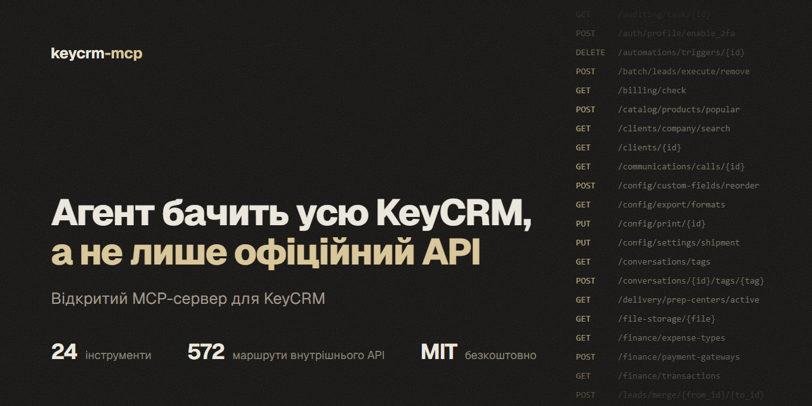
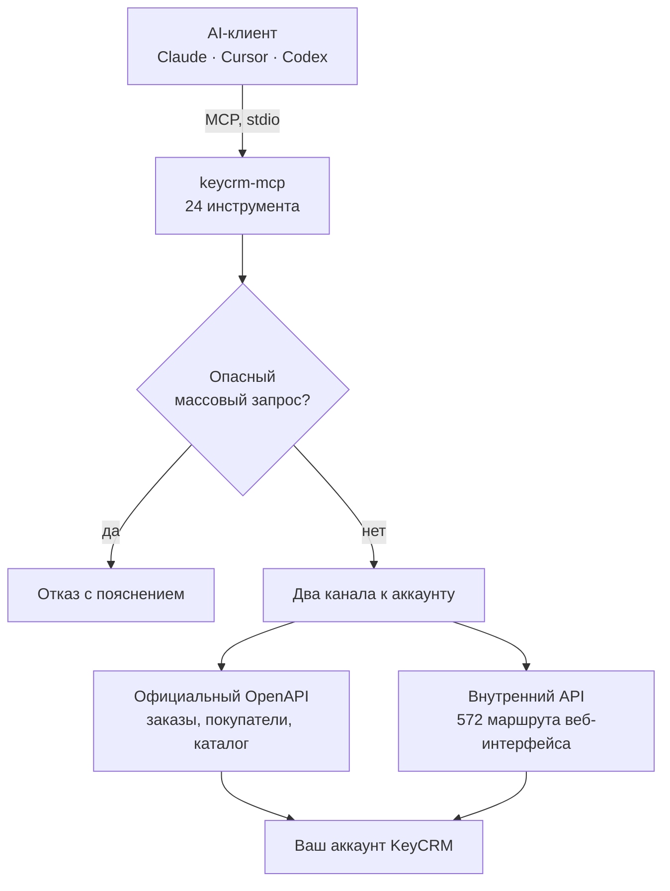

# KeyCRM MCP: неофициальный MCP-сервер для KeyCRM

[Українська](README.md) · **Русский** · [English](README.en.md)

[](https://github.com/IgorShutko/keycrm-mcp/actions/workflows/ci.yml)
[](LICENSE)
[](https://www.python.org/)
[](https://modelcontextprotocol.io/)
[](docs/TOOLS.md)
[](docs/API_REFERENCE.md)



**KeyCRM MCP** (`keycrm-mcp`): бесплатный [MCP](https://modelcontextprotocol.io/)-сервер с открытым исходным кодом, который подключает AI-агентов Claude, Cursor, Codex и других к [KeyCRM](https://keycrm.app/). Сервер работает на вашем компьютере и дает агенту лиды и воронки, заказы, покупателей, товары, склад, задачи, чаты, финансы и настройки. Он объединяет официальный OpenAPI с внутренним API веб-интерфейса: 572 маршрута, которых в официальной документации нет.

> **Неофициальный проект.** KeyCRM MCP не является продуктом компании KeyCRM, не связан с ней и ею не поддерживается. Внутренний API недокументирован: KeyCRM может изменить его с любым обновлением интерфейса. Новые сценарии сначала проверяйте на тестовом аккаунте.

- **24 инструмента** вместо сотен мелких: каждый покрывает целую сущность через параметр `action`.
- **Два канала к одному аккаунту.** Официальный OpenAPI для заказов, покупателей и каталога, внутренний API для всего остального. Сервер сам выбирает нужный.
- **572 маршрута внутреннего API** в каталоге с поиском. Если отдельного инструмента нет, агент находит маршрут и вызывает его напрямую.
- **Предохранители.** Удаление карточек воронки заблокировано на уровне сервера, опасные массовые запросы тоже. Перед рискованным действием агент делает локальный снимок аккаунта.
- **Локально.** Сервер работает через stdio, доступы лежат в переменных окружения, телеметрии нет.

## Содержание

- [Быстрый старт](#быстрый-старт)
- [Возможности](#возможности)
- [Настройка](#настройка)
- [Защита от ошибочных изменений](#защита-от-ошибочных-изменений)
- [Ограничения платформы](#ограничения-платформы)
- [Безопасность](#безопасность)
- [Как это работает](#как-это-работает)
- [Частые вопросы](#частые-вопросы)
- [Разработка](#разработка)
- [Автор и контакты](#автор-и-контакты)
- [Лицензия](#лицензия)

Документация (на русском): [быстрый старт](docs/QUICKSTART.md) · [справочник инструментов](docs/TOOLS.md) · [карта двух API](docs/API_REFERENCE.md) · [как восстанавливали внутренний API](docs/REVERSE_ENGINEERING.md) · [рецепты на Python](docs/COOKBOOK.md) · [статус всех 572 маршрутов](docs/ENDPOINTS_STATUS.md).

## Быстрый старт

**1. Что нужно.** [uv](https://docs.astral.sh/uv/getting-started/installation/) (он сам поставит Python 3.11 или новее) и Git.

**2. Доступы.** Поддомен аккаунта (для `myshop.keycrm.app` это `myshop`), e-mail и пароль пользователя KeyCRM. Сервер проверен под учетной записью владельца аккаунта.

**3. Подключите AI-клиент.** Клонировать репозиторий не нужно.

Claude Code:

```bash
claude mcp add keycrm -s user -e KEYCRM_DOMAIN=myshop -e KEYCRM_EMAIL=you@example.com -e KEYCRM_PASSWORD=REPLACE_ME -- uvx --from git+https://github.com/IgorShutko/keycrm-mcp keycrm-mcp
```

Codex:

```bash
codex mcp add keycrm --env KEYCRM_DOMAIN=myshop --env KEYCRM_EMAIL=you@example.com --env KEYCRM_PASSWORD=REPLACE_ME -- uvx --from git+https://github.com/IgorShutko/keycrm-mcp keycrm-mcp
```

Claude Desktop (`claude_desktop_config.json`), Cursor (`~/.cursor/mcp.json`), Windsurf и большинство других клиентов:

```json
{
  "mcpServers": {
    "keycrm": {
      "command": "uvx",
      "args": ["--from", "git+https://github.com/IgorShutko/keycrm-mcp", "keycrm-mcp"],
      "env": {
        "KEYCRM_DOMAIN": "myshop",
        "KEYCRM_EMAIL": "you@example.com",
        "KEYCRM_PASSWORD": "REPLACE_ME"
      }
    }
  }
}
```

Чтобы закрепить версию, добавьте тег к адресу: `git+https://github.com/IgorShutko/keycrm-mcp@v0.1.0`. Первый запуск загружает зависимости, это занимает до полуминуты.

**4. Попробуйте.** Попросите агента:

- *«Проверь подключение к KeyCRM и покажи, сколько в аккаунте лидов, заказов и товаров.»*
- *«Покажи воронку: сколько карточек в каждом статусе и какая конверсия.»*
- *«Найди карточку по телефону +380501234567 и скажи, на каком она статусе.»*
- *«Какие карточки зависли без движения более 7 дней? Сгруппируй по менеджерам.»*
- *«Создай лид в воронке 1: Иван, +380501234567, бюджет 5000, следующий контакт завтра в 12:00.»*
- *«Кто и что менял в карточке 63? Покажи историю.»*

## Возможности

| Инструмент | Что делает |
|---|---|
| `crm_status` | Профиль, состояние обоих каналов, счетчики аккаунта. С него стоит начинать сессию. |
| `leads` | Лиды и воронки: список, создание, обновление, перенос между статусами, товары в карточке, копирование. |
| `orders` | Заказы: список, создание, статусы, оплаты, расходы, товары, метки, источники. |
| `clients` | Покупатели: поиск, создание, обновление, история заказов и лидов. |
| `products` | Товары, категории, склады. |
| `tasks` | Задачи: список, поиск, создание, завершение, просроченные. |
| `conversations` | Чаты: список, сообщения, непрочитанные, отправка. |
| `users` | Пользователи, роли, права. |
| `report` | Отчеты: продажи, лиды, воронка с конверсией, нагрузка менеджеров, зависшие карточки. |
| `audit` | История изменений: кто, что и когда менял в аккаунте, в сущности или по менеджеру. |
| `settings` | Настройки аккаунта по разделам. |
| `finance` | Счета, оплаты, типы расходов, способы оплаты, курсы валют, фискализация, биллинг. |
| `delivery` | Справочники Новой Почты, Укрпочты и Rozetka Delivery: города, отделения, улицы, расчет стоимости. |
| `stocks` | Остатки, движения, инвентаризации, складская статистика. |
| `documents` | Документы по Twig-шаблону: просмотр и настоящий PDF. |
| `files` | Вложения заказов: загрузка частями до 250 МБ, скачивание, открепление. |
| `custom_fields` | Дополнительные поля: описание полей и значения в карточках. |
| `comments` | Комментарии к лидам, заказам, покупателям и сделкам. |
| `automations` | Триггеры и автоматизации, только чтение. |
| `publications` | Публикации товаров на маркетплейсах. |
| `crm_api` | Запрос к любому маршруту обоих API, с защитой от опасных массовых путей. |
| `crm_endpoints` | Поиск в каталоге 572 внутренних маршрутов. |
| `crm_capabilities` | Какие модули аккаунта активны, лимиты, известные проблемы и опасные места. |
| `crm_snapshot` | Локальный JSON-снимок карточек, заказов, товаров, покупателей и справочников перед рискованным действием. |

Все действия и параметры каждого инструмента: [справочник инструментов](docs/TOOLS.md) (на русском).

## Настройка

Сервер берет параметры из переменных окружения или из файла `.env` рядом с кодом (шаблон: [`.env.example`](.env.example)).

| Переменная | По умолчанию | Назначение |
|---|---|---|
| `KEYCRM_DOMAIN` | нет, обязательная | Поддомен аккаунта: `myshop` для `myshop.keycrm.app`. |
| `KEYCRM_EMAIL` | нет | Логин для внутреннего API. |
| `KEYCRM_PASSWORD` | нет | Пароль для внутреннего API. |
| `KEYCRM_API_TOKEN` | находится автоматически | Ключ официального OpenAPI. Если пусто, сервер берет его из настроек аккаунта через внутренний API. |
| `KEYCRM_DATA_DIR` | папка с кодом | Куда сохранять снимки (`backups/`) и скачанные файлы и PDF (`exports/`). Для запуска через `uvx` укажите свою папку. |
| `KEYCRM_OPENAPI_BASE` | `https://openapi.keycrm.app/v1` | Адрес официального API. |

Если доступов нет, сервер все равно запускается и показывает инструменты, а вызовы объясняют, чего не хватает.

## Защита от ошибочных изменений

- **Карточки воронки сервер не удаляет.** `leads(action="remove")` возвращает ошибку с пояснением. Причина: внутренний маршрут массового удаления при неточном фильтре стирает все карточки выбранных колонок. Так во время разработки исчезли 26 карточек, их восстановили со снимка. Разбор: [docs/INCIDENT.md](docs/INCIDENT.md).
- **Опасные массовые пути закрыты.** `crm_api` не пропускает `/batch/leads/execute/remove` и любые batch-запросы с параметром `column_ids`.
- **Снимок перед риском.** `crm_snapshot` сохраняет аккаунт в локальный JSON. Ключи, токены и пароли в снимке замаскированы.
- **Честные ошибки.** Сервер возвращает статус и текст ответа KeyCRM, а не выдумывает результат. При 401 он сам входит заново, при 429 ждет и повторяет до трех раз.
- **Автоматизации только для чтения.** Воронки, статусы, поля, источники и триггеры API не создает: их настраивают в интерфейсе KeyCRM.

## Ограничения платформы

Эти ограничения идут от KeyCRM, а не от сервера, и измерены на живом аккаунте:

- **Страница списка не больше 50 записей.** Внутренние списки принимают `page` и `per_page`, параметр `limit` в основном игнорируют.
- **`orderBy` не сортирует.** На `/leads`, `/tasks` и `/catalog/products` порядок одинаковый для asc и desc, на нескольких других списках параметр дает 500. Сортируйте на своей стороне.
- **Внутренний список заказов может быть пустым,** даже когда заказы существуют. Поэтому `orders.list` читает официальный API.
- **Лимиты разные.** Официальный ключ: 20 запросов в минуту. Внутренний API выдерживает около 120.
- **Часть маршрутов отвечает 500 на стороне KeyCRM:** `/finance/payments`, `/finance/transactions`, `/delivery/addresses/suggest`.
- **Отключенные модули возвращают пустые списки.** Если в аккаунте не активированы заказы, чаты или компании, пустой ответ не означает потерю данных. Проверьте через `crm_capabilities`.
- **Массовое удаление заказов асинхронное:** объект исчезает через 2-5 секунд.
- **Все даты в UTC.**

Полный перечень с подробностями: [docs/REVERSE_ENGINEERING.md](docs/REVERSE_ENGINEERING.md) и [docs/API_REFERENCE.md](docs/API_REFERENCE.md) (на русском).

## Безопасность

- Держите доступы в переменных окружения или в файле `.env`. Не вставляйте их в запросы к агенту или в аргументы инструментов. `.env`, `backups/` и `exports/` добавлены в gitignore.
- Сервер обращается только к `<ваш-поддомен>.api.keycrm.app` и `openapi.keycrm.app`. Телеметрии нет.
- Токены хранятся только в памяти процесса.
- Снимки `crm_snapshot` содержат телефоны, суммы и переписку клиентов открытым текстом. Храните папку `backups/` локально.
- Если ключ API попал в чужие руки, перевыпустите его в настройках KeyCRM. Если пароль, смените пароль.
- Сообщая об ошибке, не вставляйте в issue реальные данные клиентов или доступы.
- Модель безопасности и куда писать про уязвимость: [SECURITY.md](SECURITY.md).

## Как это работает



1. **Официальный OpenAPI** (`openapi.keycrm.app/v1`): авторизация ключом `Bearer`. Документирован и стабилен, но покрывает лишь часть CRM: 59 операций. Ключ сервер находит сам в настройках аккаунта.
2. **Внутренний API** (`<поддомен>.api.keycrm.app`): тот же, которым пользуется веб-интерфейс KeyCRM. Вход по e-mail и паролю через `POST /auth/login`, токен живет 24 часа и обновляется автоматически. Карта из 572 маршрутов в 41 группе восстановлена из JavaScript-сборки интерфейса версии v33.0.10 и лежит в [`endpoints.json`](endpoints.json).

Как именно восстанавливали внутренний API, где он ведет себя не так, как официальный, и как повторить разведку на новой версии: [docs/REVERSE_ENGINEERING.md](docs/REVERSE_ENGINEERING.md) (на русском).

## Частые вопросы

### Что такое KeyCRM MCP?

KeyCRM MCP реализует протокол Model Context Protocol для KeyCRM. Подключенный к нему AI-агент читает и меняет CRM через 24 инструмента: лиды и воронки, заказы, покупатели, товары, склад, задачи, чаты, финансы, документы и настройки. Сервер с открытым исходным кодом работает локально.

### Является ли KeyCRM MCP официальным продуктом KeyCRM?

Нет. KeyCRM MCP разрабатывается независимо и не связан с компанией KeyCRM. Сервер использует официальный OpenAPI, а все, чего там нет, делает теми же запросами, которые отправляет веб-интерфейс. Эти внутренние запросы могут измениться в любой момент.

### Чем KeyCRM MCP отличается от официального API KeyCRM?

Официальный OpenAPI имеет 59 операций и покрывает заказы, покупателей, товары и часть воронок. Внутренний API веб-интерфейса имеет 572 маршрута: задачи, комментарии, история изменений, дополнительные поля, файлы, документы, справочники доставки, складская аналитика, настройки. KeyCRM MCP работает с обоими и сам выбирает надежный канал для каждого действия.

### Какие AI-ассистенты работают с KeyCRM MCP?

Любой MCP-клиент, который умеет запускать локальный stdio-сервер: Claude Code, Claude Desktop, Cursor, OpenAI Codex, Windsurf, VS Code с GitHub Copilot, Gemini CLI, Zed, Cline и другие.

### Что нужно, чтобы подключить KeyCRM?

uv, Git, поддомен аккаунта, e-mail и пароль пользователя KeyCRM. Добавьте сервер в AI-клиент одной командой из раздела «Быстрый старт».

### Безопасно ли давать AI-агенту доступ к CRM?

Сервер закрывает самое опасное: удаление карточек воронки и массовые запросы, которые могут стереть лишнее. Перед рискованным действием агент может сделать локальный снимок аккаунта. Остальные записи выполняются сразу, поэтому новые сценарии сначала проверяйте на тестовом аккаунте, а в клиенте оставьте подтверждение перед вызовом инструментов записи.

### Можно вызвать маршрут, для которого нет отдельного инструмента?

Да. `crm_endpoints` ищет в каталоге 572 маршрутов, а `crm_api` выполняет запрос к любому из них. Статус проверки каждого маршрута: [docs/ENDPOINTS_STATUS.md](docs/ENDPOINTS_STATUS.md).

### Сколько стоит KeyCRM MCP?

KeyCRM MCP бесплатный и распространяется по лицензии MIT. Платите только за свой тариф KeyCRM и за AI-клиент, которым пользуетесь.

## Разработка

```bash
git clone https://github.com/IgorShutko/keycrm-mcp.git
cd keycrm-mcp
uv run python test_offline.py
```

`test_offline.py` не требует аккаунта: проверяет, что сервер импортируется, регистрирует все 24 инструмента и понятно сообщает об отсутствующих доступах. Ту же проверку запускает CI на Python 3.11 и 3.13.

Остальные тесты работают с живым аккаунтом: скопируйте `.env.example` в `.env` и впишите доступы. Запускайте их только на тестовом аккаунте.

- `test_smoke.py`: 92 проверки через stdio, включая полный цикл создания, обновления и удаления покупателя, товара и заказа с уборкой за собой.
- `test_domains.py`: 90 проверок доменных инструментов.
- `test_actions.py`: 83 вызова чтения всех действий, результат в [docs/ACTION_MATRIX.md](docs/ACTION_MATRIX.md).

Без MCP-клиента работает `crm_cli.py`: `uv run python crm_cli.py status`, `uv run python crm_cli.py search-endpoints tags`.

MCP-клиенты запускают сервер один раз, поэтому после изменения кода перезапустите клиент. Не публикуйте реальные данные клиентов в issues, логах и тестовых файлах.

## Автор и контакты

KeyCRM MCP создает и поддерживает Игорь Шутко, агентство [Target+](https://www.targetplus-agency.com/). Связанный проект: [Хорошоп MCP](https://github.com/IgorShutko/horoshop-mcp) для магазинов на Хорошопе.

- Telegram: [@shutko_igor](https://t.me/shutko_igor)
- Telegram-канал: [@shutko_ads](https://t.me/shutko_ads)

Ошибки и пожелания: [GitHub Issues](https://github.com/IgorShutko/keycrm-mcp/issues).

## Лицензия

[MIT](LICENSE).
